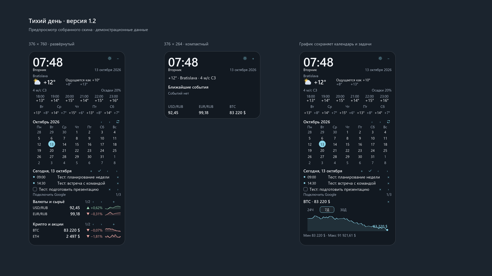

# Тихий день · Quiet Day

**RU** · [EN](#english)

Тёмный стеклянный виджет для рабочего стола Windows на [Rainmeter](https://www.rainmeter.net/): время, погода, календарь Google, задачи, курсы валют и криптовалют с графиками. Без регистрации в приложении и API-ключей. Google Календарь подключается отдельной ссылкой только для чтения.



Версия 1.2: настройки в отдельном окне, списки без потери инструментов, график сохраняет календарь и задачи. [Проверки и ограничения](docs/VALIDATION.md).

## Что умеет
- Погода: сейчас, по часам, на 5 дней. **Город меняется кликом по названию** — вводите «Вена» или «Paris, US». Источник Open-Meteo, а если он не отвечает — автоматически met.no
- Календарь с точками событий и списком дел на выбранный день
- **Задачи и события добавляются прямо в виджете** (кнопки «✓» / «+» рядом с датой, ввод вроде `18:30 Встреча`), галочка — выполнено, × — удалить. Без текстовых файлов
- **Google Календарь** — по секретной iCal-ссылке (только чтение, без OAuth); свои события показываются вместе с ним
- **Свои котировки: что интересно вам.** Два списка до 40 инструментов каждый, по две видимые строки и страницы. Кнопка «+» принимает что угодно: валюту (`CHF`), `золото`, `нефть`, `серебро`, монету (`SOL`), акцию (`AAPL`, `Tesla`), индекс (`S&P`, `NASDAQ`). Клик по строке — график 24Ч / 7Д / 30Д, правая кнопка — убрать из списка
- Валюты: ЦБ РФ (база RUB) или ЕЦБ; крипта — CoinGecko; металлы, нефть, акции, индексы — Yahoo Finance
- Компактный режим, русский и английский интерфейс
- Положение окна не «убегает» в угол после сна ноутбука

## Установка
Нужен Windows 10/11. Всё остальное (Rainmeter, Python) установщик поставит сам через `winget`.

```powershell
git clone https://github.com/Mark11Butko/tihiy-den.git
cd tihiy-den
powershell -ExecutionPolicy Bypass -File install.ps1
```
Установщик спросит язык, город и базовую валюту. Параметры можно передать сразу:
`install.ps1 -Lang ru -City Bratislava -FxBase EUR`

Программа ставится в `%LOCALAPPDATA%\TihiyDen`, скин — в папку скинов Rainmeter. Данные обновляет задача Планировщика раз в минуту (погода раз в 15 мин, курсы раз в час, крипта раз в 5 мин).

## Google Календарь
1. calendar.google.com → шестерёнка → «Настройки» → ваш календарь → «Интеграция календаря».
2. Скопируйте **«Секретный адрес в формате iCal»** (в адресе есть `private-`; «общедоступный» не подойдёт).
3. Нажмите ⚙ → «Основные» → «Подключить Google» или ↻ над календарём. Вставьте ссылку в защищённое поле; приложение сохранит её локально. Пароль Google не запрашивается.

Адрес — это ключ доступа к календарю: **не публикуйте его**. Файл `calendars.txt` лежит только у вас на компьютере и в репозиторий не попадает (`.gitignore`).

## Настройка
Значок ⚙ открывает окно настроек: язык, город, базовая валюта, масштаб 0,7–1,3, непрозрачность, акцентный цвет, формат часов и названия списков. Скин пересобирается автоматически. Минимум движения включён по умолчанию; его можно отключить для короткого перехода выбранного периода.

В списках котировок и событий используйте ‹ / ›; рядом с задачей › переключает задачи. Удаление инструмента из списка не удаляет исходные рыночные данные. Задачи — локальные, синхронизации с Google Tasks в этой версии нет.

При масштабе 1 виджет занимает 376×760 px, компактный — 376×264 px. Более крупный масштаб осознанно увеличивает эти размеры. Для ручного редактирования доступен `%LOCALAPPDATA%\TihiyDen\data\config.json`.

## Удаление
```powershell
powershell -ExecutionPolicy Bypass -File uninstall.ps1
```
Скин и папка программы уходят в Корзину, задачи Планировщика удаляются.

## Источники данных и благодарности
[Open-Meteo](https://open-meteo.com/) (погода, CC BY 4.0) · [MET Norway](https://api.met.no/) · [ЦБ РФ](https://www.cbr.ru/) · [Frankfurter / ЕЦБ](https://frankfurter.dev/) · [CoinGecko](https://www.coingecko.com/) · Yahoo Finance (неофициальный публичный API: котировки могут запаздывать, это не инвестиционная рекомендация) · [Rainmeter](https://www.rainmeter.net/). Native tab interaction inspired by [Transitions.dev](https://transitions.dev/).
Google и Google Calendar — товарные знаки Google LLC; проект с Google не связан.

## Лицензия
MIT — см. [LICENSE](LICENSE).

---

## English

A dark glass desktop widget for Windows built on [Rainmeter](https://www.rainmeter.net/): clock, weather, Google Calendar, tasks, exchange rates and a crypto chart. No app account or API keys required. Google Calendar uses a private read-only iCal link.


Version 1.2 adds native settings, paginated watchlists, and charts that keep the calendar and agenda visible. [Validation and limitations](docs/VALIDATION.md).

### Features
- Weather: now, hourly, 5-day forecast. **Change the city by clicking its name** — type "Vienna" or "Paris, US" and wait for the lookup. Open-Meteo, with automatic fallback to met.no
- Month calendar with event dots and a day agenda
- **Add tasks and events right in the widget** ("✓" / "+" buttons next to the agenda date, input like `6:30pm Meeting`), checkbox to complete, × to delete. No text files
- **Google Calendar** via the secret iCal URL (read-only, no OAuth); your own events are shown alongside it
- **Your own watchlists.** Two lists of up to 40 instruments, with two visible rows per page; the "+" button takes anything: a currency (`CHF`), `gold`, `oil`, `silver`, a coin (`SOL`), a stock (`AAPL`, `Tesla`), an index (`S&P`, `NASDAQ`). Click a row for a 24H / 7D / 30D chart, right-click to remove it
- Currencies: Bank of Russia (base RUB) or ECB; crypto — CoinGecko; metals, oil, stocks, indices — Yahoo Finance
- Compact mode, Russian and English UI
- The window no longer jumps to the screen corner after sleep

### Install
Windows 10/11. The installer fetches Rainmeter and Python via `winget` if they are missing.

```powershell
git clone https://github.com/Mark11Butko/tihiy-den.git
cd tihiy-den
powershell -ExecutionPolicy Bypass -File install.ps1 -Lang en -City Vienna -FxBase EUR
```

### Google Calendar
Calendar settings → *Integrate calendar* → copy the **Secret address in iCal format** (contains `private-`; the public address will not work). Open ⚙ → General → Connect Google, or click ↻ above the calendar, and paste the link into the masked field. Treat that URL like a password — never commit or share it.

### Configuration
The ⚙ icon opens native settings for language, city, base currency, scale, opacity, accent, clock format and list titles. Rebuilding is automatic. Reduce motion is enabled by default. Use ‹ / › to browse watchlists/events and › to browse tasks. Tasks are local; Google Tasks sync is not implemented. At scale 1, expanded is 376×760 px and compact is 376×264 px. Larger scales increase the physical dimensions. Manual settings remain in `%LOCALAPPDATA%\TihiyDen\data\config.json`.

### Uninstall
`powershell -ExecutionPolicy Bypass -File uninstall.ps1` (moves files to the Recycle Bin, removes scheduled tasks).

### Data sources
Open-Meteo (CC BY 4.0), MET Norway, Bank of Russia, Frankfurter / ECB, CoinGecko, Yahoo Finance (unofficial public API — quotes may be delayed and are not investment advice). Google and Google Calendar are trademarks of Google LLC; this project is not affiliated with Google.

### License
MIT — see [LICENSE](LICENSE).
